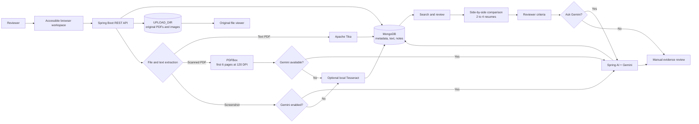
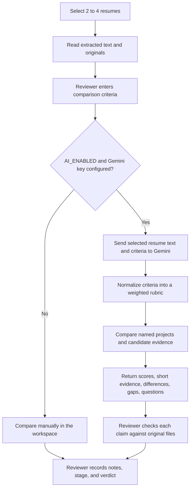

# CV Diver

### A calm, private workspace for reading and comparing resumes.

Upload up to **50 PDFs and 20 screenshots**. Search extracted text, inspect each original, keep review notes, and compare two to four resumes against evidence you choose. Gemini assistance is optional; the final review stays with you.

<p align="center">
  
  
  
  
</p>

> **Local-first by default.** Resume files and extracted text stay on your configured server. Gemini is off unless you turn it on. When enabled, the requested resume text or image is sent to Google Gemini for that operation.

## Contents

- [What you can do](#what-you-can-do)
- [Feasibility, viability, and impact](#feasibility-viability-and-impact)
- [Architecture and review workflow](#architecture-and-review-workflow)
- [Run the application](#run-the-application)
- [MongoDB setup](#mongodb-setup)
- [Environment variables](#environment-variables)
- [OCR and AI behavior](#ocr-and-ai-behavior)
- [Accessibility and privacy](#accessibility-and-privacy)
- [API](#api)
- [Troubleshooting](#troubleshooting)
- [Current scope and next steps](#current-scope-and-next-steps)

## What you can do

| Need | How CV Diver handles it |
|---|---|
| Keep a focused collection | Store up to 50 PDFs and 20 PNG/JPG screenshots; exact duplicate files are skipped by SHA-256. |
| Find a resume | Search names, tags, and extracted resume text; filter by source and review stage. |
| Read one resume carefully | View the original PDF/image alongside extracted text; add notes and move between resumes with the keyboard. |
| Compare candidates | View 2–4 originals and extracted text side by side; optionally ask Gemini to compare projects against your criteria. |
| Track review progress | Set a review stage, verdict, tags, and personal notes for each resume. |

The comparison prompt focuses on project problem, contribution, architecture, technologies, scope, outcomes, evidence, differences, and gaps to verify. It asks for a consistent weighted rubric and exact resume evidence. It explicitly avoids protected-trait evaluation and hiring recommendations.

## Feasibility, viability, and impact

### Feasibility

This workflow fits the current implementation: Spring Boot provides the local web application and REST API; MongoDB stores metadata and extracted text; files live in a configurable directory. Apache Tika reads text-based PDFs, PDFBox renders up to the first six pages of scanned PDFs for OCR, and Gemini or an optional local Tesseract installation handles images. Spring AI provides the Gemini chat integration. The expected collection size (50 PDFs and 20 screenshots) is intentionally small enough for a single-user library without a separate search cluster or vector database.

### Viability

The app runs locally with Java 21+, MongoDB, and Maven (or the included Maven Wrapper). Core library, search, original-file viewing, notes, and side-by-side comparison do not require a Gemini key. Gemini adds project comparison and image transcription; API usage may incur Google usage charges and depends on account access, network availability, quotas, and model availability. Tesseract provides an optional local OCR path without a Gemini key.

### Impact

CV Diver turns scattered PDFs and screenshots into one searchable review queue. Side-by-side source material, candidate-specific evidence, notes, and keyboard navigation reduce repetitive file switching and make project differences easier to inspect. AI output is an aid for review, not a decision: confirm every claim against the original resume.

## Architecture and review workflow



### AI “brain” and evidence workflow



## Run the application

### Requirements

- **JDK 21 or newer** (`java -version`)
- **MongoDB** running locally or reachable through a MongoDB URI
- Maven 3.9+ on `PATH`, or the included Maven Wrapper
- Optional: a Gemini API key for AI comparison and Gemini vision OCR
- Optional: Tesseract with English language data and the `tesseract` command on `PATH` for local OCR

### Windows: PowerShell, VS Code, or Antigravity

1. Start MongoDB using [MongoDB setup](#mongodb-setup).
2. Open the repository folder in your terminal or IDE.
3. Create your private environment file once:

   ```powershell
   Copy-Item .env.example .env
   ```

4. Edit `.env` if you need a different MongoDB URI, port, storage folder, or Gemini settings. See [Environment variables](#environment-variables).
5. Start the app from the repository root:

   ```powershell
   mvn spring-boot:run
   ```

   Or run the included wrapper on machines without Maven installed:

   ```powershell
   .\mvnw.cmd spring-boot:run
   ```

   In VS Code, use **Terminal → Run Task → Run CV Diver**. If `mvn` is not recognized, open a new terminal after installing Maven; the wrapper works without a global Maven installation.

6. Wait for `Started ResumeVaultApplication`, then open [http://localhost:8080](http://localhost:8080). Keep the terminal open while using the app; press **Ctrl+C** to stop it.

### macOS or Linux

From the repository root, ensure Java 21 and MongoDB are available, then run:

```bash
cp .env.example .env
./mvnw spring-boot:run
```

Open [http://localhost:8080](http://localhost:8080). If Maven is installed, `mvn spring-boot:run` also works.

## MongoDB setup

### Option A: Docker

Docker Desktop (Windows/macOS) or Docker Engine (Linux) is the quickest reproducible local setup. Start a MongoDB container with a persistent named volume:

```bash
docker run -d --name cv-diver-mongo -p 27017:27017 -v cv-diver-mongo-data:/data/db mongo:8
```

The default `.env` URI connects to the local server and uses the `CV-DIVER` database:

```dotenv
MONGODB_URI=mongodb://localhost:27017/CV-DIVER
```

Check the container with `docker ps`. To stop it, run `docker stop cv-diver-mongo`; start it again with `docker start cv-diver-mongo`. The named Docker volume preserves MongoDB data when the container stops. Back it up before removing the volume.

### Option B: MongoDB Community Server

Install MongoDB Community Server for your operating system and start its service. The default local connection is:

```text
mongodb://localhost:27017/CV-DIVER
```

For MongoDB Atlas or another server, use its full connection string in `.env` and keep credentials private. The database and `resumes` collection are created automatically on first use; no SQL schema or manual collection setup is needed.

### What is stored where

| Storage | Contents | Default location |
|---|---|---|
| MongoDB | Resume metadata, extracted text, review stage, verdict, tags, notes, upload time, file hash | Database `CV-DIVER`, collection `resumes` |
| Local filesystem | Original PDF and screenshot files | `./data/uploads` |
| Gemini (optional) | Receives only the selected comparison text/criteria or images used for Gemini OCR | Google Gemini API processing |

Back up both MongoDB and the `UPLOAD_DIR` folder. MongoDB records point to the original file paths; restoring only one side will not restore complete resumes.

## Environment variables

Copy `.env.example` to `.env`. Spring Boot loads that file for this project; shell-provided environment variables take precedence. Restart the app after changing values.

| Variable | Default | Required? | Purpose |
|---|---|---:|---|
| `PORT` | `8080` | No | HTTP port. Example: `PORT=8081`. |
| `MONGODB_URI` | `mongodb://localhost:27017/CV-DIVER` | Yes, for persistence | MongoDB connection URI; include the database name in the URI path. |
| `UPLOAD_DIR` | `./data/uploads` | No | Directory for original uploaded files. Use persistent storage when deploying. |
| `MAX_DOCUMENTS` | `70` | No | Overall library limit. The application also enforces up to 50 PDFs and 20 screenshots. |
| `AI_ENABLED` | `false` | No | Set to `true` to enable Spring AI/Gemini endpoints and Gemini vision extraction. |
| `GEMINI_API_KEY` | empty | Only if AI enabled | Private Google Gemini API key. Do not commit `.env` or paste the key into public issues. |
| `GEMINI_MODEL` | `gemini-2.5-flash` | No | Gemini model name used for chat and vision requests. |

Minimal local configuration:

```dotenv
PORT=8080
MONGODB_URI=mongodb://localhost:27017/CV-DIVER
UPLOAD_DIR=./data/uploads
MAX_DOCUMENTS=70
AI_ENABLED=false
GEMINI_API_KEY=
GEMINI_MODEL=gemini-2.5-flash
```

To enable Gemini, set `AI_ENABLED=true`, provide your key in `GEMINI_API_KEY`, save `.env`, and restart the application. No API key is required for the core library. Local Tesseract OCR is separate and does not require a Gemini key.

## OCR and AI behavior

- **Text PDFs:** Apache Tika extracts embedded text at upload time.
- **Scanned PDFs:** PDFBox renders up to the first six pages at 120 DPI. With Gemini enabled those pages are transcribed by Gemini; otherwise local Tesseract is attempted.
- **Screenshots:** Gemini vision is used when enabled. Otherwise the app attempts local Tesseract.
- **Tesseract:** install Tesseract and English language data, then make sure `tesseract --version` works in the same environment that runs Java. No executable path setting is required.
- **No OCR available:** the original image/PDF remains viewable; extracted text may be empty and will not be searchable.
- **AI comparison:** select 2–4 resumes, review the source material, enter criteria, then choose **Ask AI to compare evidence**. The server sends up to 12,000 characters of extracted text per selected resume to Gemini.

OCR can misread names, dates, numbers, and columns. Gemini can also produce inaccurate comparisons. Always check the original source before relying on extracted text or AI output.

## Accessibility and privacy

The interface provides a skip link, semantic table structure, labeled controls, visible keyboard focus, live status announcements, responsive layouts, and reduced-motion support. In the resume viewer, use **J/K** or arrow keys to move between visible resumes; press **1/2/3** to record Priority, Shortlist, or Reject. You can read original files alongside recognized text and copy extracted text.

Files and metadata are stored on the server configured by you. With AI disabled, resume content is not sent to Gemini. With AI enabled, screenshot contents may be sent during OCR, and selected extracted resume text plus your criteria are sent when you request an AI comparison. Configure access and retention accordingly.

This is a single-workspace application without sign-in, authorization roles, or multi-tenant isolation. Keep it on a trusted local network; add authentication and deployment hardening before exposing it to other users or the public internet. CV Diver does not scrape LinkedIn. Upload resumes you are allowed to process.

## API

| Method | Endpoint | Purpose |
|---|---|---|
| `GET` | `/api/resumes?q=java` | List resumes; optionally search names, tags, and extracted text. |
| `POST` | `/api/resumes` | Upload files as multipart field `files`. Supports PDF, PNG, JPG, and JPEG. |
| `GET` | `/api/resumes/{id}` | Read resume details and extracted text. |
| `GET` | `/api/resumes/{id}/file` | Read the original file. |
| `PATCH` | `/api/resumes/{id}` | Update `stage`, `verdict`, `notes`, or comma-separated `tags`. |
| `DELETE` | `/api/resumes/{id}` | Delete the resume record and its stored file. |
| `POST` | `/api/resumes/compare` | Load 2–4 selected resumes for side-by-side review. |
| `POST` | `/api/ai/compare` | Request criteria-based comparison when AI is enabled. |

## Troubleshooting

| Symptom | What to check |
|---|---|
| `mvn` is not recognized | Run `./mvnw` (macOS/Linux) or `\.mvnw.cmd` (PowerShell) from the repository root. For a Maven install, start a fresh IDE terminal after updating `PATH`. |
| `java` is not recognized or below 21 | Install a JDK 21 or newer, open a fresh terminal, and verify with `java -version`. |
| MongoDB connection refused | Start MongoDB or Docker container; verify `MONGODB_URI` and port 27017. |
| Port 8080 is already in use | Stop the other process or set `PORT=8081`, restart, and open `http://localhost:8081`. |
| Gemini comparison is missing | Set both `AI_ENABLED=true` and `GEMINI_API_KEY`, then restart the app. |
| Screenshot text is blank | Configure Gemini or install Tesseract plus English data; check `tesseract --version`. The original file remains available. |
| Changes to `.env` have no effect | Confirm `.env` is in the repository root and restart Spring Boot. Shell environment variables override `.env`. |

## Current scope and next steps

**Implemented:** local library, PDF/image upload, duplicate detection, text extraction and OCR fallbacks, search, source viewing, review notes/stages/verdicts, 2–4-way comparisons, optional Gemini evidence summaries, and keyboard-assisted review.

**Not included yet:** user accounts, role-based access, team collaboration, cloud deployment automation, automatic LinkedIn ingestion, semantic/vector search, or a full conversational chat history. Keep backups of both the MongoDB database and uploaded files.

### Final setup checklist

- [ ] Java 21+ is available.
- [ ] MongoDB is running and `.env` points to it.
- [ ] `UPLOAD_DIR` is writable and backed up if resumes matter.
- [ ] `mvn spring-boot:run` or the Maven Wrapper starts the application.
- [ ] The browser opens `http://localhost:8080`.
- [ ] If using Gemini, `AI_ENABLED=true` and `GEMINI_API_KEY` are set privately.

---

**CV Diver is ready for a private, local resume-review workflow.** Verify every extracted detail, keep the original files available, and treat AI output as an evidence-finding aid rather than a decision.
